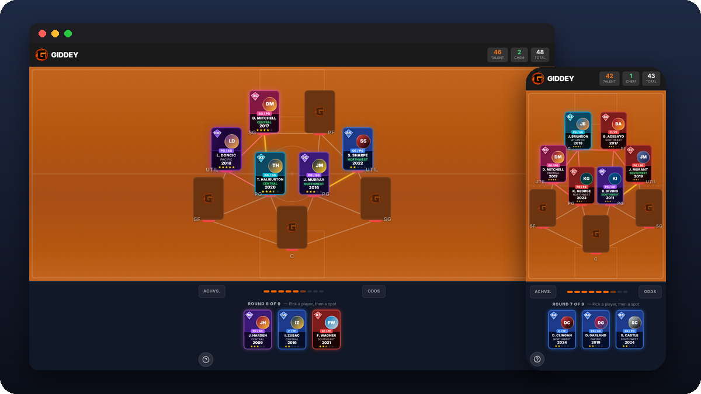

I'm a full-stack and iOS developer based in South Jersey. I lead development at a test-prep company, co-founded [Mile A Day](https://mileaday.run), and build web and mobile apps on the side.

[robwiscount.org](https://robwiscount.org) · [Mile A Day on the App Store](https://apps.apple.com/app/mile-a-day/id6744917105) · [Instagram](https://instagram.com/robwizzie)

### Featured work

<table>
<tr>
<td width="50%" valign="top">

<b><a href="https://github.com/robwizzie/Mile-A-Day">Mile A Day</a></b> 
iOS app for keeping a daily one-mile streak, with friend competitions, widgets and a watchOS app. 
SwiftUI · HealthKit · Express · PostgreSQL

</td>
<td width="50%" valign="top">

<b><a href="https://github.com/robwizzie/top-dogs-pool">Top Dawgs</a></b> 
Team site for an APA pool team: stats scraped from the league portal, match recaps, drills and a live scoring app. 
Next.js · Supabase · Playwright · Cloudflare

</td>
</tr>
<tr>
<td width="50%" valign="top">

<b><a href="https://github.com/robwizzie/Giddey">Giddey</a></b> 
Daily basketball draft puzzle where you score on player ratings and on-court chemistry. 
Next.js · TypeScript · Supabase

</td>
<td width="50%" valign="top">

<b><a href="https://github.com/robwizzie/troubled-brewing">Trouble Brewing</a></b> 
Website and custom CMS for a coffee shop in Haddon Heights, NJ, with menu sync from its POS. 
React · Vite · Supabase · GSAP

</td>
</tr>
<tr>
<td width="50%" valign="top">

<b><a href="https://github.com/robwizzie/jawn-legends">Jawn Legends</a></b> 
Philadelphia-themed pixel-art monster game for iPhone, shipped through TestFlight. 
JavaScript · Canvas · Capacitor

</td>
<td width="50%" valign="top">

<b><a href="https://github.com/robwizzie/pick-5">Pick5</a></b> 
Weekly NFL pick'em with private leagues and odds-based scoring. 
Next.js · MongoDB · NextAuth

</td>
</tr>
</table>

### Other projects

| Project | Description | Stack |
|---|---|---|
| [Fantasy Flicks](https://github.com/robwizzie/FantasyFlicks) | Movie fantasy leagues, group movie-night matching and Letterboxd sync | SwiftUI, Firebase |
| [Dialed](https://github.com/robwizzie/Dialed) | Personal health dashboard that turns Apple Health data into one daily score | SwiftUI, HealthKit |
| [Fetch](https://github.com/robwizzie/fetch) | Local multiplayer party game ([playable in the browser](https://robwiscount.org/play/fetch/)) | Godot 4 |
| [LeBronify](https://github.com/robwizzie/LeBronify) | Parody music player with Live Activities and widgets | SwiftUI, ActivityKit |
| [Unused CSS Detector](https://github.com/robwizzie/unused-css-detector) | VS Code extension that flags unused CSS across HTML and JS | TypeScript |

### Tools I use most

Swift and SwiftUI, TypeScript, React, Next.js, Node and Express, PostgreSQL, Supabase, MongoDB, Linux servers.
