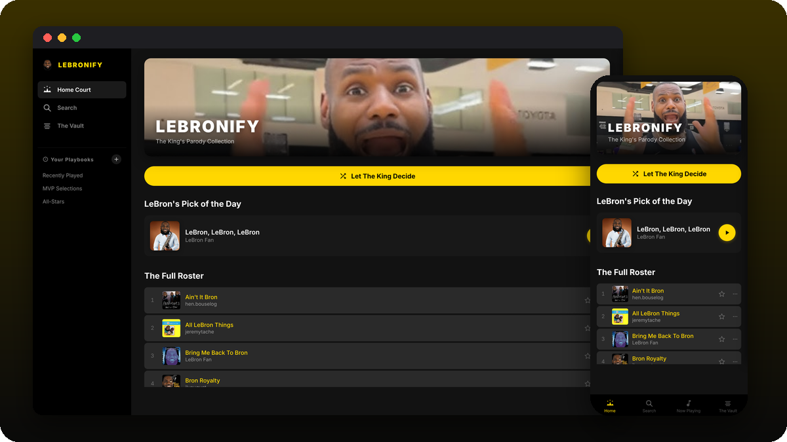
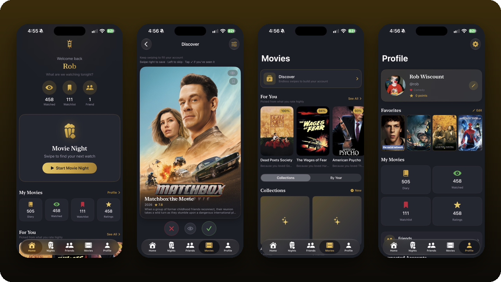
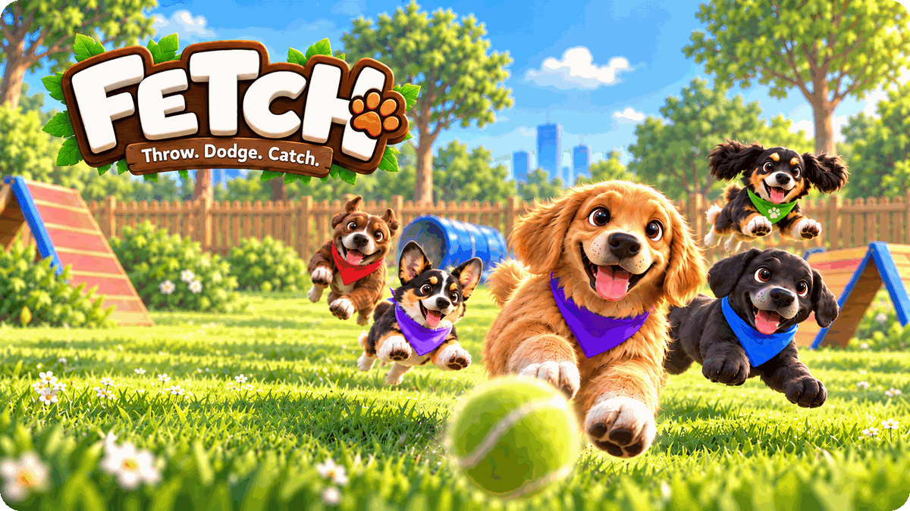
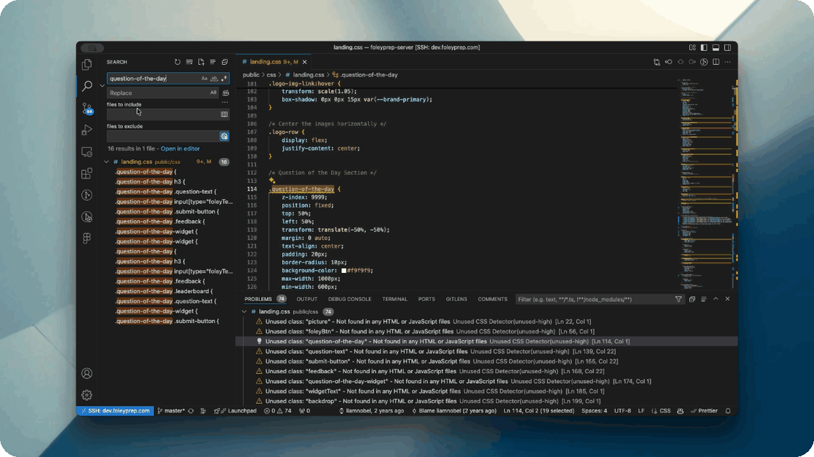

<p align="center">
  
</p>

<p align="center">
  <a href="https://robwiscount.org"></a>
  <a href="https://mileaday.run"></a>
  <a href="https://instagram.com/robwizzie"></a>
</p>

### 🔥 the short version

I'm a full-stack + iOS developer who can't stop building things for the people around me.
My buddy Dave and I bet a Call of Duty skin on who could run a mile every day the longest. Nobody lost.
368 days later we turned it into [**Mile A Day**](https://github.com/robwizzie/Mile-A-Day), and now it's on the App Store with a mascot named Flamey who really, really wants you to go run.

By day I'm the main developer behind a test-prep company's whole platform. By night I'm building pool-team stat sites, coffee-shop websites, basketball puzzle games, a Philly monster game for a buddy, and a LeBron music player that nobody asked for.

```ts
const rob = {
  ships: ["iOS apps", "full-stack web", "VS Code extensions", "LED desk gadgets"],
  stack: ["SwiftUI", "HealthKit", "TypeScript", "Next.js", "React", "Node/Express", "Postgres", "Supabase", "MongoDB"],
  dailyMile: true,          // non-negotiable
  poolTeam: "Top Dawgs 🎱",   // APA 8-ball, South Jersey
  sideProjects: Infinity,   // finished side projects: also a number
};
```

<p align="center"></p>

## 🛠️ Stuff I've built

<table>
<tr>
<td width="50%" valign="top">
<a href="https://github.com/robwizzie/Mile-A-Day"></a>
<h3>🔥 Mile A Day</h3>
Run (or walk) one mile every day and keep Flamey alive. Streaks, friend races, medals, widgets, a Watch app, and an LED desk counter that shows live stats.<br/>
<sub><b>SwiftUI · HealthKit · watchOS · Express · Postgres · Next.js</b> · <a href="https://mileaday.run">mileaday.run</a></sub>
</td>
<td width="50%" valign="top">
<a href="https://github.com/robwizzie/jawn-legends"></a>
<h3>🦅 Jawn Legends</h3>
A Philly pocket-monster idle game I built as a gift for a friend. Pixel art, catch and battle jawns around the city, minigames, a dad-to-be-of-twins storyline.<br/>
<sub><b>Vanilla JS · Canvas · Capacitor iOS</b> · on TestFlight</sub>
</td>
</tr>
<tr>
<td width="50%" valign="top">
<a href="https://github.com/robwizzie/top-dogs-pool"></a>
<h3>🎱 Top Dawgs</h3>
My APA 8-ball team's home base: roster, live stats, standings, match breakdowns, shot drills and the Rack Up scoreboard we use on league night.<br/>
<sub><b>Next.js · Supabase · Cloudflare</b> · <a href="https://poolmaxxing.com">poolmaxxing.com</a></sub>
</td>
<td width="50%" valign="top">
<a href="https://github.com/robwizzie/Giddey"></a>
<h3>🏀 Giddey</h3>
A daily basketball draft puzzle. Nine rounds, three cards each, no undo. Build chemistry on the grid and chase 279.<br/>
<sub><b>Next.js · TypeScript · Supabase</b> · <a href="https://playgiddey.com">playgiddey.com</a></sub>
</td>
</tr>
<tr>
<td width="50%" valign="top">
<a href="https://github.com/robwizzie/pick-5"></a>
<h3>🏈 Pick5</h3>
Five NFL picks every week, scored by the odds, so calling the upset actually pays. Leagues, leaderboards and weekly bragging rights for the group chat.<br/>
<sub><b>Next.js · MongoDB · NextAuth · Odds API</b></sub>
</td>
<td width="50%" valign="top">
<a href="https://github.com/robwizzie/troubled-brewing"></a>
<h3>☕ Trouble Brewing</h3>
The website for a coffee house in Haddon Heights, NJ, with its own CMS so the staff can update the menu, events and chalkboard without me.<br/>
<sub><b>React · Vite · GSAP · Supabase</b></sub>
</td>
</tr>
<tr>
<td width="50%" valign="top">
<a href="https://github.com/robwizzie/LeBronify"></a>
<h3>👑 LeBronify</h3>
A parody music player for iOS. Every song is about LeBron. The ads are Anthony Davis. There's a Dynamic Island. I regret nothing.<br/>
<sub><b>SwiftUI · AVFoundation · Live Activities · WidgetKit</b></sub>
</td>
<td width="50%" valign="top">
<a href="https://github.com/robwizzie/FantasyFlicks"></a>
<h3>🎬 Fantasy Flicks</h3>
Fantasy football, but for movies. Draft upcoming releases with friends and score on real box office, plus Oscar picks, movie nights and a Letterboxd-synced diary.<br/>
<sub><b>SwiftUI · Firebase</b></sub>
</td>
</tr>
<tr>
<td width="50%" valign="top">
<a href="https://github.com/robwizzie/fetch"></a>
<h3>🐕 Fetch</h3>
A couch-multiplayer party game where 2–4 dogs throw toys at each other. Throw, dodge, catch. <a href="https://robwiscount.org/play/fetch/">Play it in your browser.</a><br/>
<sub><b>Godot 4 · GDScript · 3D</b></sub>
</td>
<td width="50%" valign="top">
<a href="https://github.com/robwizzie/Dialed"></a>
<h3>📈 Dialed</h3>
My personal fitness OS. Pulls sleep, workouts, water and weight from Apple Health into one daily score, plus a head-to-head weight-loss challenge with a friend.<br/>
<sub><b>SwiftUI · SwiftData · HealthKit · Vision</b></sub>
</td>
</tr>
<tr>
<td colspan="2" valign="top">
<a href="https://github.com/robwizzie/unused-css-detector"></a>
<h3>🧹 Unused CSS Detector</h3>
A VS Code extension that finds CSS nobody uses anymore by following your HTML, scripts and imports, then underlines the dead weight like an unused variable.
Published on the VS Code Marketplace and Open VSX.<br/>
<sub><b>TypeScript · VS Code API</b></sub>
<br clear="right"/>
</td>
</tr>
</table>

## 🚧 currently tinkering with

- 📺 turning the LG TV downstairs into a custom home screen: Jellyfin front and center, lights on a button, house lights flash team colors when the Eagles, Sixers or Phillies win
- 🟥 LED desk counters that show live Mile A Day stats (Matrix Portal + a 3D-printed case off my Bambu A1)
- 🕹️ party games for a friend's homemade two-screen arcade cabinet
- 🏃 today's mile, obviously

## 🐍 my contributions, being eaten

<picture>
  <source media="(prefers-color-scheme: dark)" srcset="https://raw.githubusercontent.com/robwizzie/robwizzie/output/snake-dark.svg" />
  
</picture>

<p align="center">
  
</p>
<p align="center"><sub>built in South Jersey · fueled by coffee and a daily mile · <a href="https://robwiscount.org">robwiscount.org</a></sub></p>
