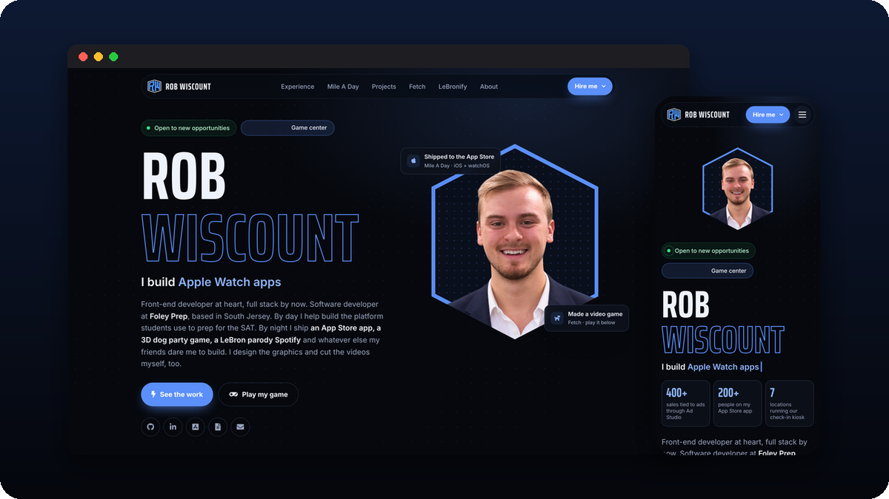
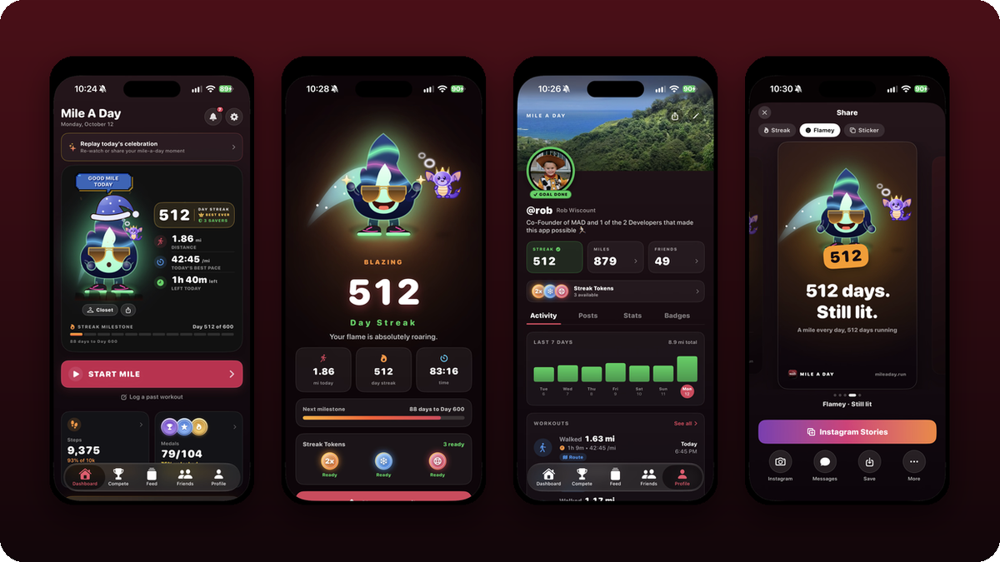
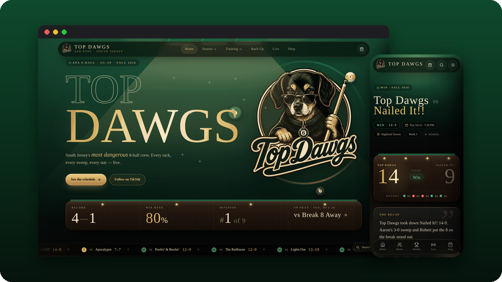
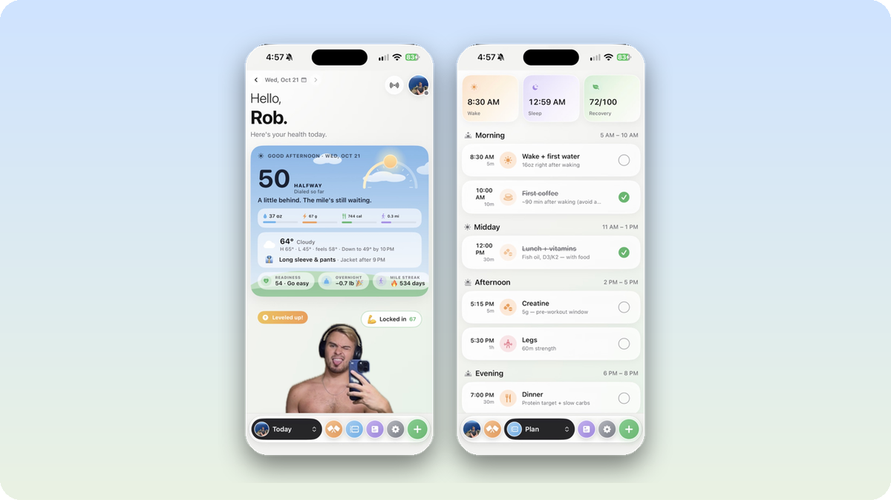
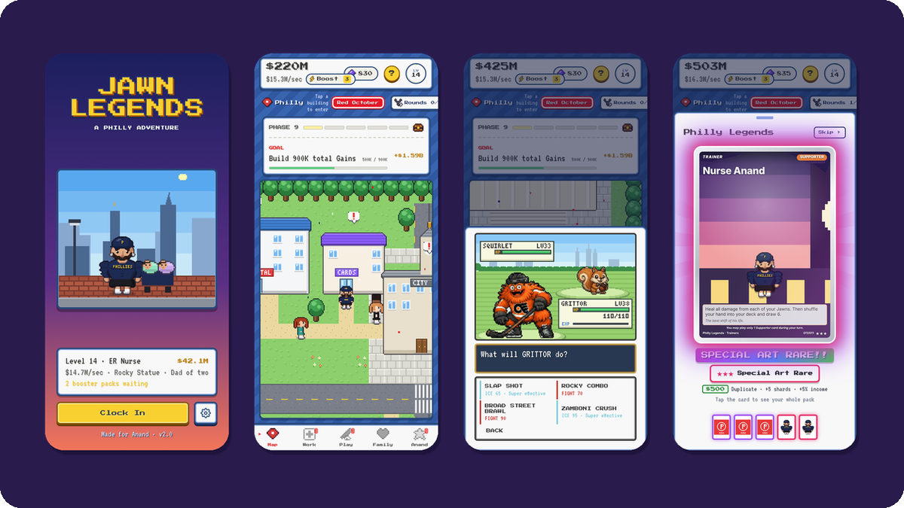
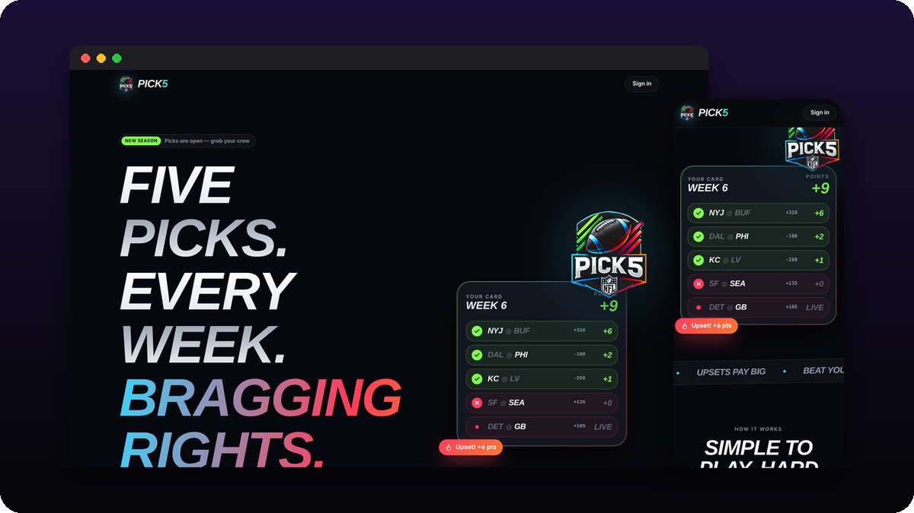
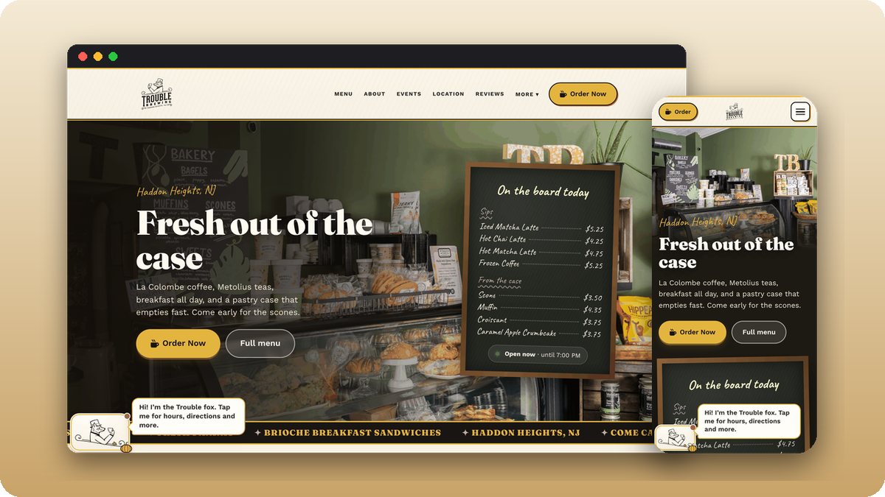
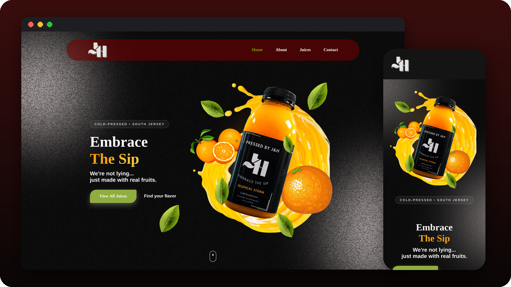

 

I'm a full-stack and iOS developer in South Jersey. I lead development at a test-prep company, co-founded [Mile A Day](https://mileaday.run) (an app for running a mile every single day), and spend my nights building things for the people around me: my pool team, a local coffee shop, my friends' group chats.

  <a href="https://robwiscount.org"><b>robwiscount.org</b></a> &nbsp;·&nbsp;
  <a href="https://apps.apple.com/app/mile-a-day/id6744917105">Mile A Day on the App Store</a> &nbsp;·&nbsp;
  <a href="https://instagram.com/robwizzie">Instagram</a>

 

## Featured work

<table>
<tr>
<td width="50%" valign="top">

<a href="https://robwiscount.org"><b>robwiscount.org</b></a> My portfolio, with live visitor cursors, a guestbook and a game you can play right on the page. HTML · CSS · JavaScript · Cloudflare Workers  

</td>
<td width="50%" valign="top">

<a href="https://github.com/robwizzie/Mile-A-Day"><b>Mile A Day</b></a> Run or walk a mile every day and keep Flamey alive. Streaks, friend races, widgets and a watchOS app. SwiftUI · HealthKit · Express · PostgreSQL  

</td>
</tr>
<tr>
<td width="50%" valign="top">

<a href="https://github.com/robwizzie/top-dogs-pool"><b>Top Dawgs</b></a> Home base for my APA pool team: stats scraped from the league portal, match recaps, drills and live scoring. Next.js · Supabase · Playwright  

</td>
<td width="50%" valign="top">

<a href="https://github.com/robwizzie/Dialed"><b>Dialed</b></a> My personal health app. It turns sleep, workouts, water and food into one daily score and a plan for the day. SwiftUI · HealthKit · SwiftData  

</td>
</tr>
<tr>
<td width="50%" valign="top">

<a href="https://github.com/robwizzie/jawn-legends"><b>Jawn Legends</b></a> A Philly monster-catching game for iPhone that I made as a gift for a friend. Pixel art, battles and card packs. JavaScript · Canvas · Capacitor  

</td>
<td width="50%" valign="top">

<a href="https://github.com/robwizzie/pick-5"><b>Pick5</b></a> Weekly NFL pick'em for the group chat. Picks are scored by the odds, so calling the upset pays more. Next.js · MongoDB · NextAuth  

</td>
</tr>
<tr>
<td width="50%" valign="top">

<a href="https://github.com/robwizzie/troubled-brewing"><b>Trouble Brewing</b></a> Website and custom CMS for a Haddon Heights coffee shop, with an animated fox who helps you pick a drink. React · Vite · Supabase · GSAP  

</td>
<td width="50%" valign="top">

<a href="https://github.com/robwizzie/responsive-juice-website"><b>Pressed By J&amp;H</b></a> Storefront for a South Jersey cold-pressed juice company, with Stripe checkout. HTML · CSS · Node · Stripe  

</td>
</tr>
</table>

 

## More things I've built

| Project | What it is | Built with |
|---|---|---|
| **[Giddey](https://github.com/robwizzie/Giddey)** | Daily basketball draft puzzle at [playgiddey.com](https://playgiddey.com) | Next.js |
| **[Fantasy Flicks](https://github.com/robwizzie/FantasyFlicks)** | Fantasy leagues and group movie nights for film people | SwiftUI, Firebase |
| **[Fetch](https://github.com/robwizzie/fetch)** | Couch-multiplayer dog party game, [playable in your browser](https://robwiscount.org/play/fetch/) | Godot 4 |
| **[LeBronify](https://github.com/robwizzie/LeBronify)** | A music player where every song is a LeBron parody | SwiftUI |
| **[Unused CSS Detector](https://github.com/robwizzie/unused-css-detector)** | VS Code extension that finds CSS nobody uses anymore | TypeScript |

 

The numbers in the header are live: they refresh once a month from the Mile A Day API and my pool team's stats.
